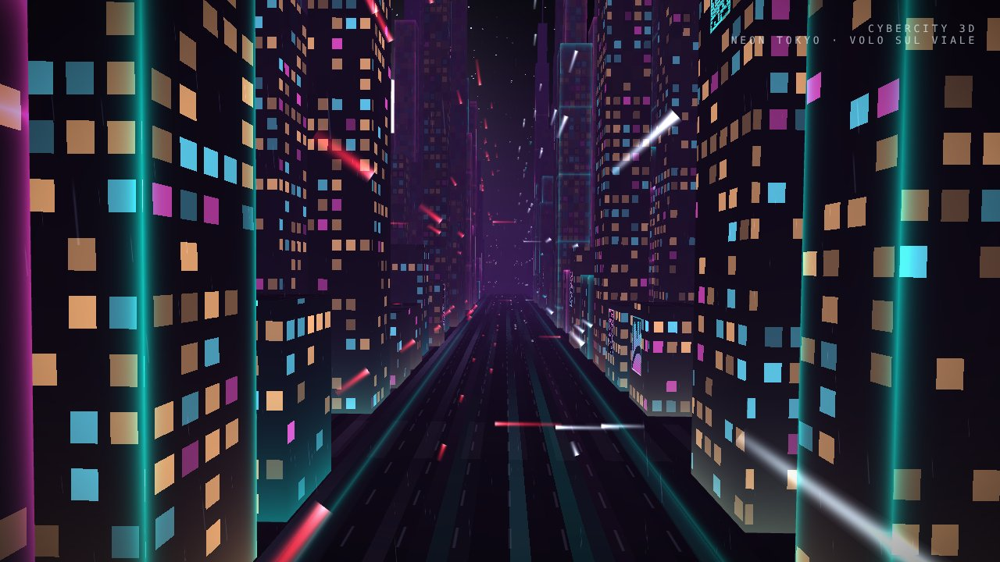
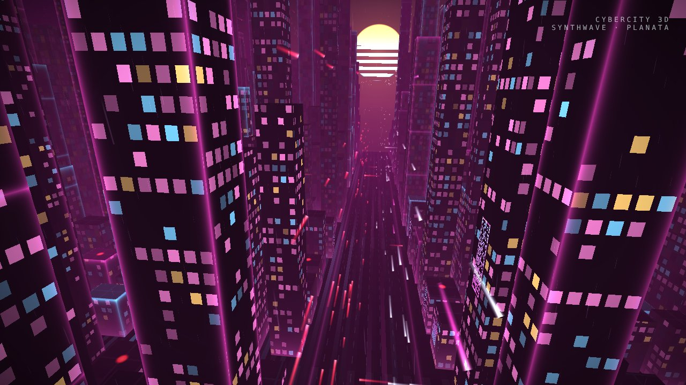
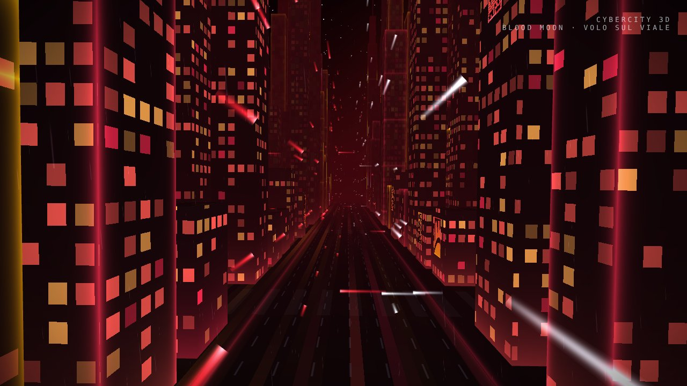

# Cybercity 3D 🌃

Salvaschermo 3D cyberpunk della famiglia Ampy: un volo infinito dentro una megalopoli procedurale al neon,
con pioggia, traffico volante, insegne olografiche e orologio glitch. Android 8 → Android 17 (DreamService OpenGL ES 2)
più una versione **browser / PC** con lo stesso motore e gli stessi shader.

| | |
|---|---|
|  |  |
|  |  |

## Scarica
- **Android**: Releases → `latest` → `Cybercity3D.apk` (oppure Actions → ultimo build → artifact `Cybercity3D-APK`).
- **Browser / PC**: Releases → `Cybercity3D.html`, oppure apri `docs/index.html`. Per averla online: Settings → Pages → *Deploy from a branch* → `main` / `docs` → https://frak89.github.io/Cibercity-3D/
  Doppio clic = schermo intero, `Spazio` = cambia telecamera, `P` = cambia atmosfera, ⚙ in basso a destra per le opzioni.

## Attivarlo come salvaschermo (Pixel / Android)
1. Installa l'APK e aprilo: parte l'anteprima dal vivo.
2. Tocca **IMPOSTA COME SALVASCHERMO** → *Salvaschermo* → scegli **Cybercity 3D** → *Quando avviarlo* (in carica / sul dock).
3. L'ingranaggio accanto a Cybercity 3D nelle impostazioni di sistema apre le opzioni.

## Programmazione (Impostazioni → PROGRAMMAZIONE)
- **Luminosità personalizzata**: come il sistema oppure 1–100%, più una luminosità separata per pause e momenti nascosti.
- **Fasce orarie**: quante ne vuoi, ognuna con orari, giorni (L M M G V S D), cosa mostrare
  (**città 3D**, **solo orologio**, **schermo nero**, **non mostrare**), atmosfera, telecamera e luminosità propria.
  Esempio predefinito: *SERA* 19:00–23:00 Neon Tokyo al 60%, *NOTTE* 23:00–07:00 solo orologio Blood Moon all'8%.
  Opzione: fuori dalle fasce non mostrare la città.
- **Orario di lavoro / non disturbare**: dalle–alle e giorni (predefinito lun–ven 9–18): in quell'orario niente città.
  **Rispetta il Non disturbare di Android** (anche modalità Focus / Riposo).
- **Ciclo**: solo in carica, ritardo dopo la messa in carica, durata animazione e pausa prima che ricompaia.

- **Rovescia il telefono** (schermo in giù) per spegnere il salvaschermo: schermo nero e 3D fermo, si riaccende quando lo giri (oppure: chiudi / ignora).
- **Icone notifiche** sotto l'orologio al posto delle icone di sistema (Wi-Fi ecc.): una per app, senza numeri. Richiede l'accesso alle notifiche.

Quando il salvaschermo *parte* lo decide Android (Display → Salvaschermo → *Quando avviarlo*, più il timeout dello schermo):
il programma di Cybercity regola cosa succede da quel momento.

## Cosa c'è dentro
- **Città procedurale infinita**: ~700 grattacieli con piani a gradoni, guglie, megatorri; finestre che si accendono e spengono, piani-ufficio illuminati, bordi e fasce al neon pulsanti, luci aeronautiche sui tetti.
- **4 telecamere** + modalità AUTO con dissolvenza: *Volo sul viale*, *Planata*, *Drone a bassa quota*, *Sopra i tetti*.
- **6 atmosfere**: Neon Tokyo, Blade Runner, Matrix, Synthwave (sole a strisce), Blood Moon, Futuristic Glass — stessi colori dei temi AmpyRocket / AmpyRAW.
- **Traffico volante** su 5 livelli, strade a terra e incroci, skyway sopra i tetti: scie bianche se vengono verso di te, rosse se si allontanano.
- **Insegne olografiche** animate: colonne di glifi che scorrono, equalizzatori, loghi ad anello, con glitch.
- **Pioggia**, nebbia volumetrica, asfalto bagnato con riflessi, stelle, luna/sole.
- **Orologio glitch** (decodifica lettera per lettera come AmpyRocket) che si sposta un po' ogni minuto per proteggere gli schermi OLED.
- Opzioni: velocità, pioggia, campo visivo, durata inquadrature, scanlines CRT, schermo attenuato, qualità (60/85/100% risoluzione), 30/45/60 FPS, 5 piante della città.

## Struttura
```
app/src/main/assets/shaders/   GLSL ES 1.0 condivisi da Android e web
app/src/main/java/it/ampy/cybercity/
  City.java            generatore (porting 1:1 di buildCity in web/cybercity.js, stesso PRNG)
  CityRenderer.java    renderer GLES2
  CyberDreamService    il salvaschermo
  MainActivity         anteprima + collegamenti
  SettingsActivity     opzioni
web/cybercity.js, web/template.html   motore WebGL
tools/build_web.py     genera docs/index.html (singolo file autonomo)
```

## Build
GitHub Actions compila a ogni push (`.github/workflows/android-apk.yml`) e pubblica la release `latest` con APK e HTML.
Firma stabile opzionale con i secrets `CYBERCITY_KEYSTORE_B64`, `CYBERCITY_STORE_PASSWORD`, `CYBERCITY_KEY_ALIAS`, `CYBERCITY_KEY_PASSWORD`
(senza secrets l'APK è firmato con chiave debug: per aggiornare può servire disinstallare la versione precedente).
In locale: Android Studio, JDK 17, Gradle 8.13, SDK 36. Dopo aver toccato shader o motore web: `python3 tools/build_web.py`.

Davide Fraccaro · [Frak89](https://github.com/Frak89)
